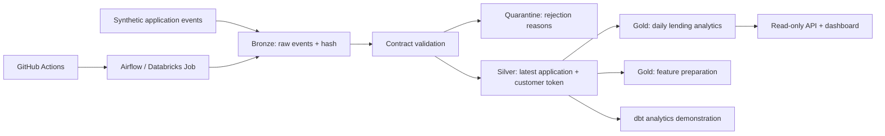

# CreditFlow Data Platform

[](https://github.com/lipsapriyadarsinee101-oss/creditflow-data-platform/actions/workflows/ci.yml)

An end-to-end **synthetic lending data platform** for a Senior Data Engineer portfolio. Turn application events into reliable reporting and reusable feature data, with a runnable Python demo and a Spark/Delta implementation for Databricks.

The focus is operational engineering: replay-safe ingestion, deterministic change handling, quality gates, privacy boundaries, analytics modelling, orchestration, and deployment. It is an independent educational project with no affiliation to Europace, M&M, inovex, or Kake.

## Architecture



## Start locally in five minutes

Python 3.11+ is required. The core has **no third-party runtime dependencies**.

```bash
git clone https://github.com/lipsapriyadarsinee101-oss/creditflow-data-platform.git
cd creditflow-data-platform
python -m venv .venv
# Linux/macOS: source .venv/bin/activate
# Windows PowerShell: .venv\Scripts\Activate.ps1
python -m pip install -e .
```

Set a demo key (for synthetic records only):

```bash
export CREDITFLOW_TOKEN_KEY='synthetic-local-demo-key'
# PowerShell: $env:CREDITFLOW_TOKEN_KEY = 'synthetic-local-demo-key'
creditflow generate --rows 10000
creditflow run
creditflow run
creditflow export
creditflow serve
```

Open **http://127.0.0.1:8000/** for the dashboard, **/v1/daily** for JSON, and **/health** for the last successful run. The second ingestion reports `changed: 0`. Each successful run has an audit record, even on replay.

```bash
python -m unittest discover -s tests -v
python scripts/benchmark.py --rows 100000
```

The input contains application amount, income, term, status, channel, and version timestamp. It contains **no names, emails, addresses, or real financial information**.

## What is implemented

| Capability | Implementation | Verification |
|---|---|---|
| ETL and modelling | Bronze/silver/gold Python pipeline | Integration tests + local demo |
| Change handling | Latest UTC timestamp; hash tie-break | Replay and out-of-order tests |
| Data quality | Shared contracts, quarantine, reject threshold | Invalid input and rollback tests |
| Privacy | HMAC customer tokens, aggregate-only API | Token and export tests |
| Reporting | Daily KPIs, dbt models and reconciliation | Local tests; dbt CI job |
| AI preparation | Application-level feature view without outcome label | Export smoke test |
| API and visualization | Read-only JSON API and dashboard | HTTP smoke test |
| Spark + Delta Lake | Batch MERGE, quarantine, deduplication | Syntax checked; requires Databricks integration run |
| Orchestration | Airflow 3 reference DAG and Databricks job bundle | Syntax checked; scheduler not run locally |
| CI/CD | Python/dbt verification and manual dev deployment | GitHub workflows included |
| Infrastructure as Code | Azure resource group, storage, workspace, ADF | Terraform template; not provisioned |
| Governance | Product ownership, classifications, SQL grants, runbook | Documented; real tenant policies require review |

## Repository map

- `src/creditflow/`: contracts, generator, transactional pipeline, API, CLI, dashboard.
- `tests/`: executable integration tests.
- `spark/` and `databricks.yml`: Delta lakehouse and deployable development job.
- `analytics/`: dbt DuckDB models, tests, and seed configuration.
- `orchestration/`: Airflow DAG.
- `infra/`: Azure Terraform baseline.
- `governance/`: data products and example access grants.
- `docs/`: architecture, cloud setup, operations, privacy, interview walkthrough.
- `scripts/`: reproducible benchmark and analytics seed generator.
- `.github/workflows/`: verification and manual deployment.

## Analytics with dbt

```bash
pip install -e '.[analytics]'
python scripts/seed_dbt.py
dbt seed --project-dir analytics --profiles-dir analytics
dbt build --project-dir analytics --profiles-dir analytics
dbt docs generate --project-dir analytics --profiles-dir analytics
```

The seed generator runs the validated local pipeline and selects only non-customer fields. The dbt project is a separate DuckDB analytics demonstration; it is not connected to the Databricks silver table. Run these commands from the repository root; the default database path is data/analytics.duckdb.

## Containers

```bash
docker compose run --rm demo
```

This runs generation, ingestion, and export in a persistent named volume. For an interactive dashboard use the local CLI above.

## Cloud and operations

Read [Cloud deployment](docs/cloud.md), [Architecture decisions](docs/architecture.md), [Operations](docs/runbook.md), and [Privacy boundaries](docs/privacy.md) before deploying. Cloud setup requires your own subscription, workspace, compute, secret scope, catalog permissions, and synthetic source volume.

**Scope:** this is a working portfolio foundation. Local tests do not prove cloud compatibility or GDPR compliance. There is no trained credit scoring model, automated lending decision, Kafka streaming deployment, production SLA, or real customer connector. Money uses floating-point values in the demo; production financial accounting requires fixed decimal types and reconciled source-of-truth contracts.

## Recruiter walkthrough

See [Interview walkthrough](docs/interview.md) for a 10-minute demonstration and a mapping to senior data engineering responsibilities.
